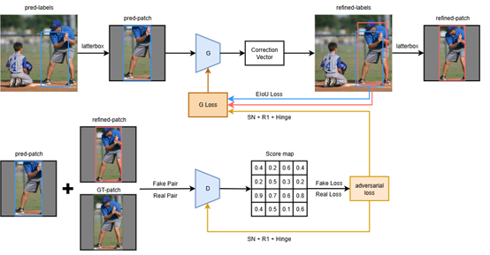
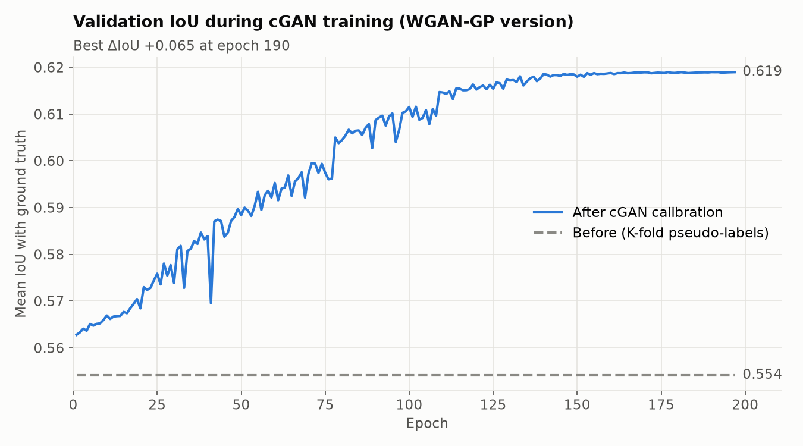
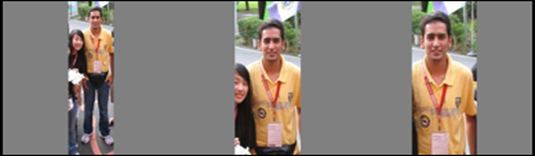
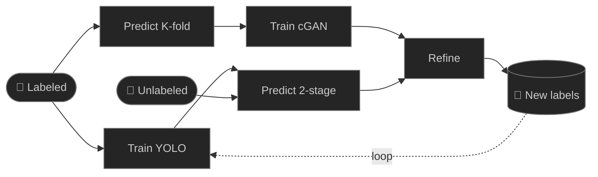
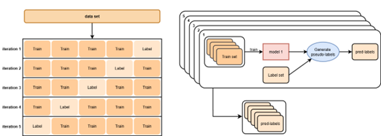

# cGAN Pseudo-Label Refinement for Semi-Supervised Object Detection

**English** | [繁體中文](README.zh-TW.md)

In semi-supervised object detection, a teacher model trained on a few labeled images draws boxes (pseudo-labels) on the unlabeled images, and a student learns from them. With little labeled data, those boxes are often in roughly the right place but too loose, too tight or shifted, and the student learns the errors. This project trains a **conditional GAN whose generator looks at the image inside a pseudo-box and predicts how to move and resize it**. Its training pairs come from K-fold cross-prediction on the labeled set, so the generator sees realistic teacher mistakes next to the true boxes.

Undergraduate research project, Department of Applied Mathematics, Chung Yuan Christian University (2025); also entered in a student competition.



## Results

Results reported in the project write-up, on a COCO *person* subset with 1%, 5% and 10% of the images labeled (Δ = with refinement − without):

| Labeled images | Pseudo-label IoU Δ | mAP@50 Δ | mAP@[.5:.95] Δ |
|---|---|---|---|
| 1% | +0.043 | +0.79 pp | +0.57 pp |
| 5% | +0.074 | +1.33 pp | +0.96 pp |
| 10% | +0.081 | +1.46 pp | +1.05 pp |

<sub>pp = percentage points. The datasets, logs and weights behind this table are not stored in this repository.</sub>

The included training log comes from an earlier version of the calibrator trained with a WGAN-GP objective. On held-out K-fold pairs, it raised the mean IoU between pseudo-boxes and ground truth from **0.554 to 0.619** (+0.065) over 197 epochs:



Example refinement (left to right: teacher's pseudo-box, refined box, ground truth):



For scale, a YOLOv8s teacher trained on 500 labeled images reached mAP@50 0.528 and mAP@50-95 0.209 on a 100-image validation split. That is the regime where pseudo-labels are noisy enough for refinement to matter.

## Pipeline



| Stage | What happens | Script |
|---|---|---|
| Data | Extract the *person* class from COCO and split it into labeled / validation / unlabeled parts | `pipeline/01_coco_to_yolo.py`, `02_split_dataset.py` |
| 1. Teacher | Train YOLOv8 on the labeled part | `pipeline/03_train_teacher.py` |
| 2a. K-fold pseudo-labels | Split the labeled part into K folds; train on K−1 folds and predict the held-out fold. Every labeled image gets predictions from a model that never saw it, paired with its true boxes. | `pipeline/04_kfold_pseudo_labels.py`, `05_build_cgan_dataset.py` |
| 2b. Two-stage pseudo-labels | Predict the unlabeled images with a high confidence threshold, then again with a low threshold to recover missed objects that do not overlap the confident boxes | `pipeline/06_two_stage_pseudo_labels.py` |
| 3. cGAN | Train the calibrator on the K-fold pairs, then refine the two-stage pseudo-labels | `cgan/train.py`, `cgan/inference.py` |
| 4. Iterate | Train a new teacher on labeled + refined pseudo-labels and repeat | `03_train_teacher.py` with `configs/person_round2.yaml` |
| Evaluation | Precision, recall, F1 and per-box IoU change of pseudo-labels before and after refinement | `pipeline/07_evaluate_pseudo_labels.py` |



## Method

**Training pairs.** Each K-fold pseudo-box is matched to the ground-truth box with the highest IoU (kept if IoU ≥ 0.25; several pseudo-boxes may match the same object). The target correction is

$$\Delta = \left(\frac{x_{gt} - x_p}{s},\ \frac{y_{gt} - y_p}{s},\ \log\frac{w_{gt}}{w_p},\ \log\frac{h_{gt}}{h_p}\right), \qquad s = \max\left(\sqrt{w_p h_p},\ 0.05\right),$$

so shifts are measured relative to the box size and scale changes are symmetric in log space.

**Generator.** The region inside the pseudo-box is cropped and letterboxed to 224×224 (*pred patch*). A Swin-T encoder (ImageNet-pretrained, via `timm`) and a U-Net decoder with skip connections produce a feature map that is pooled into the four values of Δ. Applying Δ gives the refined box, and its region is cropped from the original image again (*refined patch*).

**Discriminator.** A PatchGAN with spectral normalization and a projection term. It sees the pred patch together with either the ground-truth patch (real) or the refined patch (fake) and scores each local region.

**Losses.**

| | Loss |
|---|---|
| Generator | EIoU between refined box and ground truth + λ_adv · hinge adversarial loss |
| Discriminator | Hinge loss + R1 gradient penalty on real pairs (λ = 0.1, every 32 steps) |

EIoU penalizes overlap, center distance and width/height differences separately, so the generator gets a useful signal even when a box is mostly correct. Earlier versions used BCE + Smooth-L1 and then WGAN-GP. The current version uses spectral normalization with R1 and hinge losses instead, because R1 is cheaper and simpler than the WGAN-GP gradient penalty. Settings are in [`cgan/config.yaml`](cgan/config.yaml).

## Run it

```bash
pip install -r requirements.txt
```

Run every command from the repository root. Data and outputs go to `datasets/` and `runs/`, which are git-ignored.

```bash
# Data: COCO 2017 annotations and images → YOLO format, person only
python pipeline/01_coco_to_yolo.py --json instances_train2017.json --images-dir train2017 \
       --category person --out-dir datasets/coco_person
python pipeline/02_split_dataset.py              # → datasets/person/part1 (labeled), part2 (val), part3 (unlabeled)

# Stage 1–2
python pipeline/03_train_teacher.py              # → runs/teacher/person_v1/weights/best.pt
python pipeline/04_kfold_pseudo_labels.py        # → datasets/kfold/merged_pseudo/labels
python pipeline/05_build_cgan_dataset.py         # → datasets/cgan_train_set/{images,labels_gt,labels_pred}
python pipeline/06_two_stage_pseudo_labels.py    # → datasets/two_stage/stage2/high

# Stage 3
python cgan/train.py                             # → runs/cgan/G_best.pth, training_history.json
python cgan/inference.py --weights runs/cgan/G_best.pth \
       --source datasets/two_stage/stage2/high/images --labels datasets/two_stage/stage2/high/labels \
       --output datasets/calibrated --copy-images

# Evaluation and Stage 4
python pipeline/07_evaluate_pseudo_labels.py --gt-dir datasets/person/part3/labels \
       --pre-dir datasets/two_stage/stage2/high/labels --post-dir datasets/calibrated/labels
# then set DATA_YAML = "configs/person_round2.yaml" and NAME = "person_v2" in 03_train_teacher.py
```

Split sizes, folds, thresholds and epochs are constants at the top of each script. The defaults are 1,500 labeled and 300 validation images, 15 folds, and 400 epochs with early stopping. `cgan/train.py` defaults to batch size 128, which fits in 24 GB of GPU memory; lower `--batch_size` on smaller GPUs.

Tools:

- `tools/check_delta.py` checks that decoding the target Δ really moves pseudo-boxes onto the ground truth.
- `tools/create_paired_patches.py` saves pseudo/ground-truth patch pairs side by side for inspection.
- `cgan/diagnose_generator.py` shows how the generator behaves for boxes of different starting IoU.
- `tools/plot_training_history.py` draws the IoU curve from `training_history.json`.

Each stage was checked end to end on a small synthetic dataset.

## Project structure

```
├── cgan/
│   ├── models.py            Swin-UNet generator, projection PatchGAN discriminator
│   ├── losses.py            EIoU, hinge, R1, Δ encoding/decoding
│   ├── dataset.py           pseudo/ground-truth matching, letterboxed patches
│   ├── train.py             adversarial training loop
│   ├── inference.py         refine a folder of YOLO pseudo-labels
│   ├── diagnose_generator.py
│   └── config.yaml
├── pipeline/                stages 1–4 and evaluation (01–07)
├── tools/                   sanity checks and plots
├── configs/                 YOLO dataset configs
├── results/                 training log and IoU curve
└── docs/images/
```

## References

1. P. Isola et al. Image-to-image translation with conditional adversarial networks (pix2pix). CVPR 2017.
2. Z. Liu et al. Swin Transformer: hierarchical vision transformer using shifted windows. ICCV 2021.
3. T. Miyato, M. Koyama. cGANs with projection discriminator. ICLR 2018.
4. T. Miyato et al. Spectral normalization for generative adversarial networks. ICLR 2018.
5. L. Mescheder, A. Geiger, S. Nowozin. Which training methods for GANs do actually converge? (R1 penalty). ICML 2018.
6. Y.-F. Zhang et al. Focal and efficient IOU loss for accurate bounding box regression (EIoU). Neurocomputing 2022.
7. L. Zhang et al. Mind the gap: polishing pseudo labels for accurate semi-supervised object detection. AAAI 2023.
