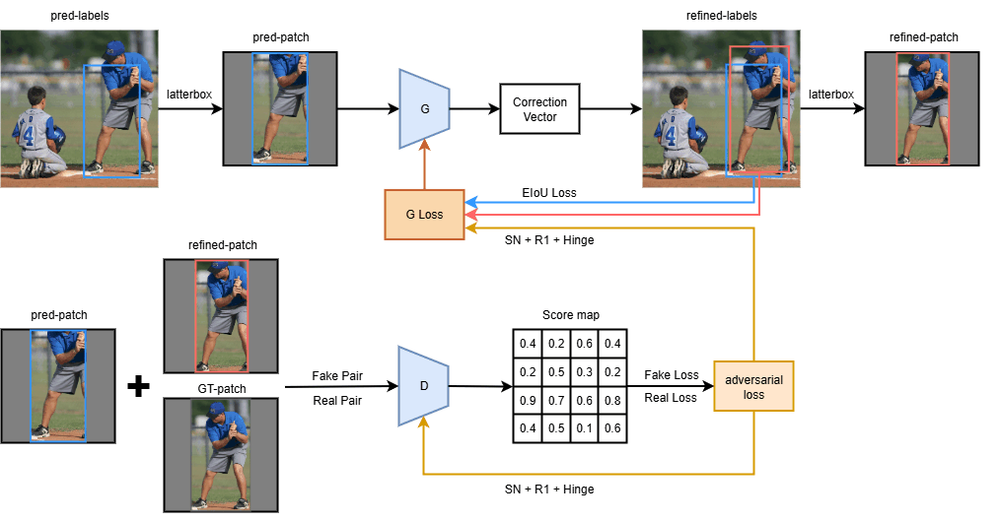
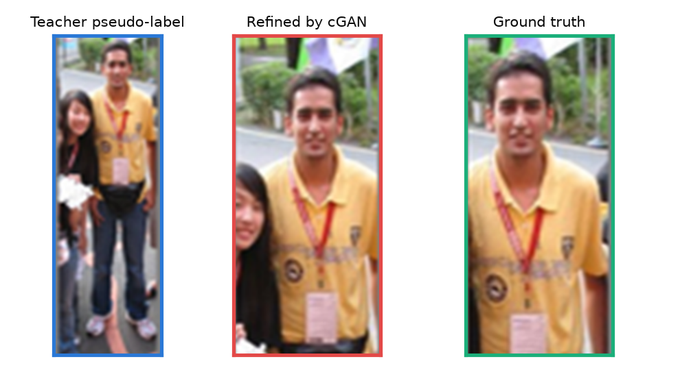
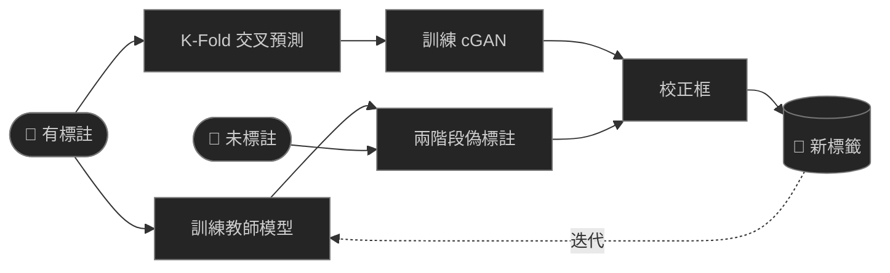
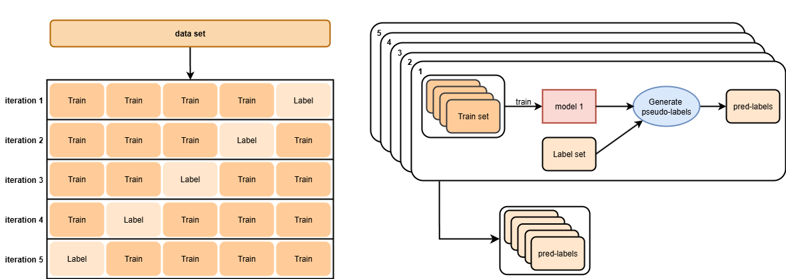
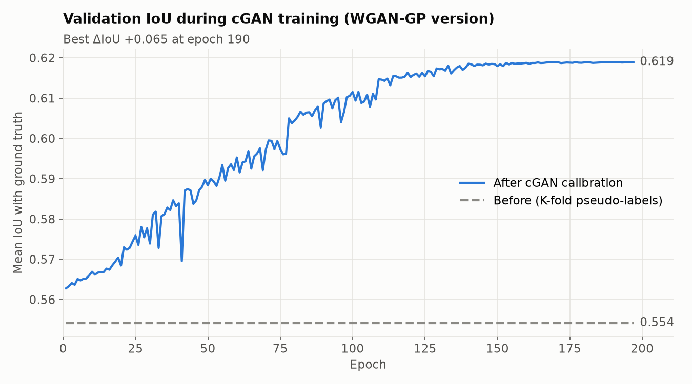

<h1 align="center">基於 cGAN 的偽標籤校正</h1>

<p align="center">讓條件式 GAN 學會修正半監督物件偵測中教師模型畫錯的框</p>

<p align="center"><a href="README.md">English</a> | <b>繁體中文</b></p>

<p align="center">
  
</p>

半監督物件偵測中，先用少量有標註的影像訓練教師模型，讓它替未標註影像畫框（偽標籤），下一個模型再從這些框學習。標註很少時，這些框通常有找到物件，但會太鬆、太緊或偏移。本專案訓練一個**條件式 GAN，讓生成器看偽標籤框內的影像，預測該如何移動、縮放這個框**。訓練資料來自 K-Fold 交叉預測，因此生成器學到的是教師模型真實會犯的錯。

中原大學應用數學系專題研究（2025），並參加競賽。

## 成果摘要

在 COCO *person* 子集上，分別只標註 1%、5%、10% 的影像（Δ = 有校正 − 無校正）：

| 標註比例 | 偽標籤 IoU | mAP@50 | mAP@[.5:.95] |
|:---:|:---:|:---:|:---:|
| 1% | +0.043 | +0.79 pp | +0.57 pp |
| 5% | +0.074 | +1.33 pp | +0.96 pp |
| 10% | +0.081 | +1.46 pp | +1.05 pp |

<sub>pp = 百分點。數據取自專題報告；對應的資料集、訓練紀錄與權重未收錄在本 repo。</sub>

<p align="center">
  
</p>

## 運作方式



1. **教師模型**：用有標註影像訓練 YOLOv8。
2. **K-Fold 偽標籤（cGAN 的訓練資料）**：把有標註影像切成 K 折，以 K−1 折訓練、預測剩下那一折。每張有標註影像都會得到「沒看過它的模型」畫的框，並與真實框配對。
3. **兩階段偽標籤（待校正）**：先以高置信度門檻預測未標註影像，再以低門檻預測一次，補回與高信心框重疊不大的漏檢物件。
4. **cGAN**：用 K-Fold 配對訓練校正器，再用它校正兩階段偽標籤。
5. **迭代**：用「有標註 + 校正後偽標籤」訓練新的教師模型，重複上述流程。

<p align="center">
  
</p>

### 校正器

每個 K-Fold 偽標籤框與 IoU 最高的真實框配對（IoU ≥ 0.25 才保留）。生成器學習的校正量為

$$
\Delta = \left(\frac{x_{gt} - x_p}{s},\ \frac{y_{gt} - y_p}{s},\ \log\frac{w_{gt}}{w_p},\ \log\frac{h_{gt}}{h_p}\right), \qquad s = \max\left(\sqrt{w_p h_p},\ 0.05\right)
$$

位移以框的大小為單位，縮放取對數，放大與縮小對稱。

| 部分 | 設計 |
|---|---|
| 輸入 | 偽標籤框內的區域，letterbox 成 224×224（*pred patch*） |
| 生成器 | Swin-T 編碼器（ImageNet 預訓練）+ 帶跳接的 U-Net 解碼器 → 池化 → Δ；再從原圖裁出校正後的區域（*refined patch*） |
| 判別器 | 使用譜正規化並帶投影項的 PatchGAN；輸入 pred patch 搭配真實框 patch（真）或 refined patch（假） |
| 生成器損失 | 校正後框與真實框的 EIoU + λ<sub>adv</sub> · hinge 對抗損失 |
| 判別器損失 | Hinge 損失 + 對真實配對的 R1 梯度懲罰（λ = 0.1，每 32 步計算一次） |

EIoU 分別懲罰重疊度、中心距離與寬高差異，即使框已大致正確，生成器仍能得到有用的梯度。早期版本依序使用過 BCE + Smooth-L1、WGAN-GP；現行版本改用譜正規化搭配 R1 與 hinge 損失，因為 R1 比 WGAN-GP 的梯度懲罰更省計算、也更簡單。所有參數設定見 [`cgan/config.yaml`](cgan/config.yaml)。

### 訓練曲線

repo 內附的訓練紀錄來自較早的 WGAN-GP 版本：在保留的 K-Fold 驗證配對上，偽標籤框與真實框的平均 IoU 經 197 個 epoch 由 **0.554 提升到 0.619**。

<p align="center">
  
</p>

作為參考：只用 500 張標註影像訓練的 YOLOv8s 教師模型，在 100 張驗證影像上的 mAP@50 為 0.528、mAP@50-95 為 0.209。標註這麼少時，偽標籤誤差大到值得校正。

## 開始使用

```bash
pip install -r requirements.txt
```

所有指令都在 repo 根目錄執行；資料與輸出放在 `datasets/`、`runs/`（不納入 git）。`part1–3` 分別是有標註、驗證、未標註資料。

| 階段 | 程式 | 輸出 |
|---|---|---|
| 資料 | `pipeline/01_coco_to_yolo.py`（參數見下方） | `datasets/coco_person/` |
| 資料 | `pipeline/02_split_dataset.py` | `datasets/person/part1–3/` |
| 1&nbsp;·&nbsp;教⁠師 | `pipeline/03_train_teacher.py` | `runs/teacher/person_v1/` |
| 2&nbsp;·&nbsp;偽⁠標⁠籤 | `pipeline/04_kfold_pseudo_labels.py` | `datasets/kfold/` |
| 2&nbsp;·&nbsp;偽⁠標⁠籤 | `pipeline/05_build_cgan_dataset.py` | `datasets/cgan_train_set/` |
| 2&nbsp;·&nbsp;偽⁠標⁠籤 | `pipeline/06_two_stage_pseudo_labels.py` | `datasets/two_stage/` |
| 3&nbsp;·&nbsp;cGAN | `cgan/train.py` | `runs/cgan/G_best.pth` |
| 3&nbsp;·&nbsp;cGAN | `cgan/inference.py`（參數見下方） | `datasets/calibrated/` |
| 評估 | `pipeline/07_evaluate_pseudo_labels.py`（參數見下方） | Precision／Recall／F1、IoU&nbsp;變化 |
| 4&nbsp;·&nbsp;下⁠一⁠輪 | `pipeline/03_train_teacher.py`，把 `DATA_YAML` 改為 `"configs/person_round2.yaml"`、`NAME` 改為 `"person_v2"` | `runs/teacher/person_v2/` |

```bash
python pipeline/01_coco_to_yolo.py --json instances_train2017.json --images-dir train2017 \
    --category person --out-dir datasets/coco_person

python cgan/inference.py --weights runs/cgan/G_best.pth \
    --source datasets/two_stage/stage2/high/images --labels datasets/two_stage/stage2/high/labels \
    --output datasets/calibrated --copy-images

python pipeline/07_evaluate_pseudo_labels.py --gt-dir datasets/person/part3/labels \
    --pre-dir datasets/two_stage/stage2/high/labels --post-dir datasets/calibrated/labels
```

切分數量（預設 1,500 張有標註、300 張驗證）、折數（15）、門檻與 epoch 數都是各腳本開頭的常數。`cgan/train.py` 預設批次大小 128，需要 24 GB 顯存；顯存較小時請調低 `--batch_size`。每個階段都已用小型合成資料完整跑過一次。

<details>
<summary><b>工具</b></summary>

| 程式 | 用途 |
|---|---|
| `tools/check_delta.py` | 確認把目標 Δ 解碼回去後，偽標籤框確實會移到真實框上 |
| `tools/create_paired_patches.py` | 把偽標籤與真實框的 patch 並排存成圖片，方便檢查 |
| `cgan/diagnose_generator.py` | 分析生成器對不同初始 IoU 的框如何反應 |
| `tools/plot_training_history.py` | 由 `training_history.json` 畫出 IoU 曲線 |

</details>

## 專案結構

```
├── cgan/          模型、損失函數、資料集、訓練、推論、config.yaml
├── pipeline/      01–07：資料準備、教師模型、偽標籤、評估
├── tools/         檢查與繪圖工具
├── configs/       YOLO 資料設定
├── results/       訓練紀錄與 IoU 曲線
└── docs/images/
```

<details>
<summary><b>參考文獻</b></summary>

1. P. Isola et al. Image-to-image translation with conditional adversarial networks (pix2pix). CVPR 2017.
2. Z. Liu et al. Swin Transformer: hierarchical vision transformer using shifted windows. ICCV 2021.
3. T. Miyato, M. Koyama. cGANs with projection discriminator. ICLR 2018.
4. T. Miyato et al. Spectral normalization for generative adversarial networks. ICLR 2018.
5. L. Mescheder, A. Geiger, S. Nowozin. Which training methods for GANs do actually converge? (R1 penalty). ICML 2018.
6. Y.-F. Zhang et al. Focal and efficient IOU loss for accurate bounding box regression (EIoU). Neurocomputing 2022.
7. L. Zhang et al. Mind the gap: polishing pseudo labels for accurate semi-supervised object detection. AAAI 2023.

</details>
